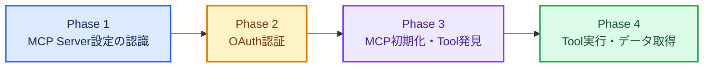
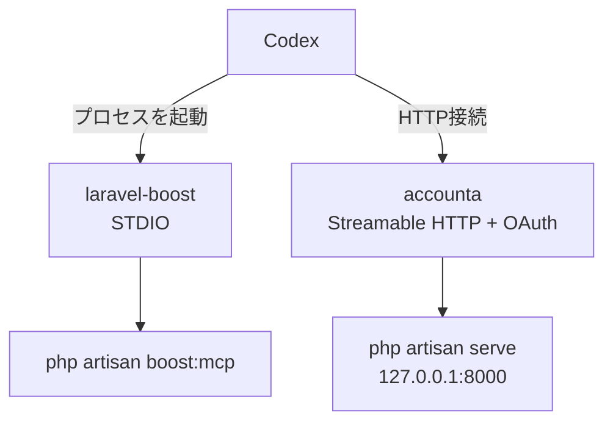
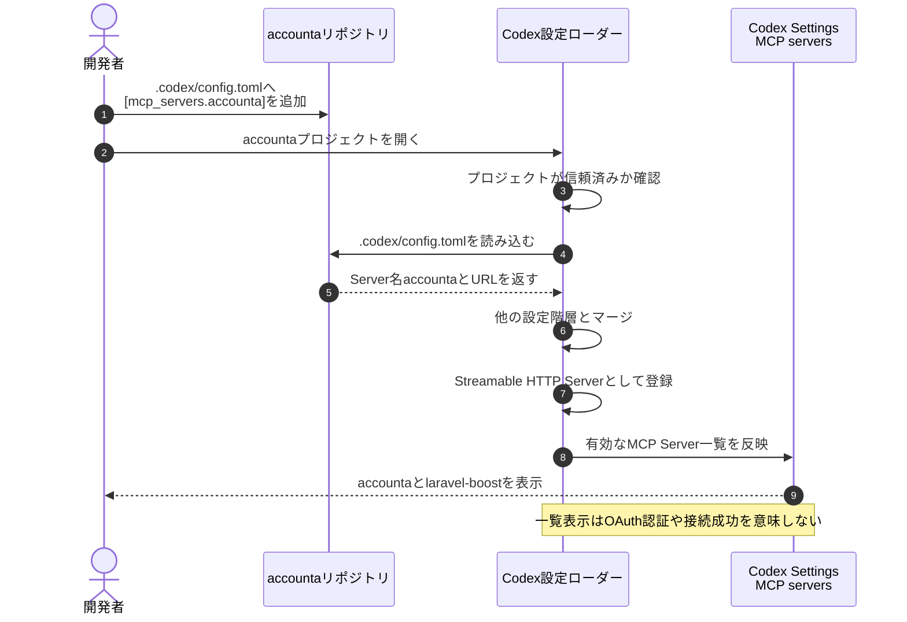
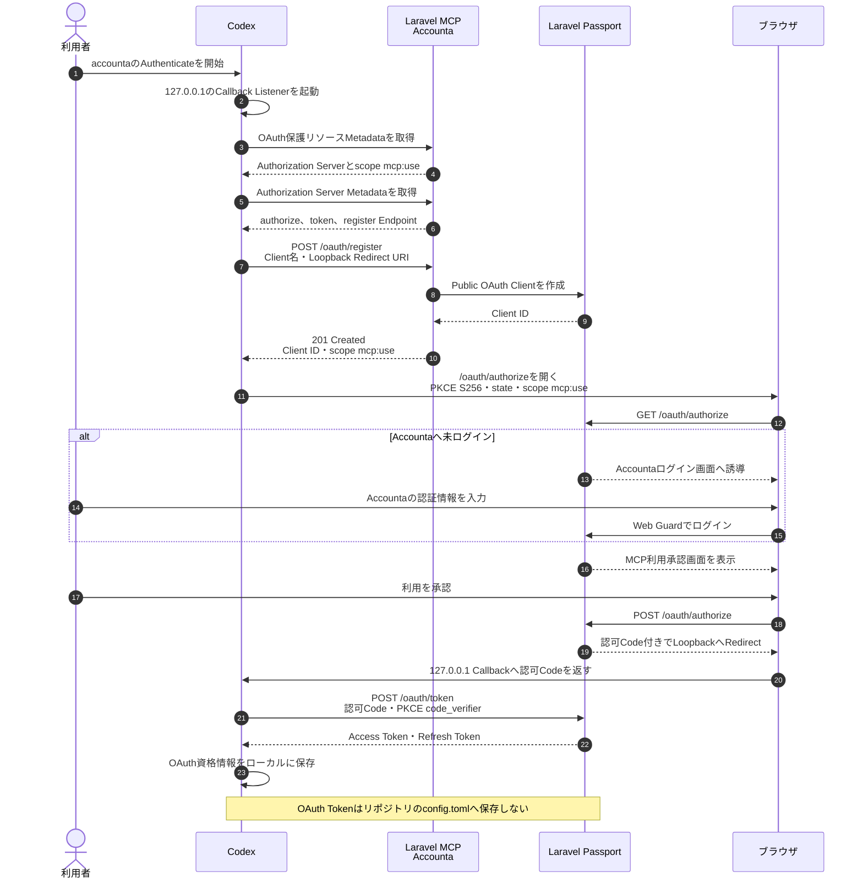
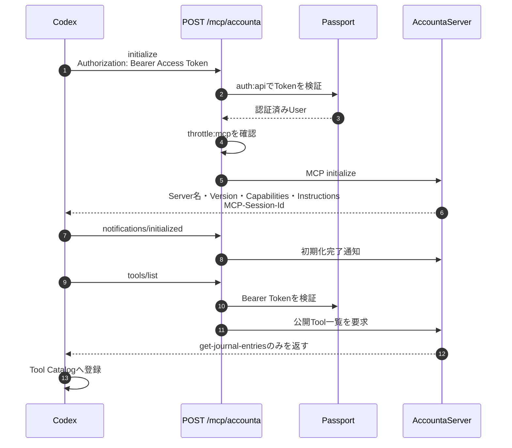
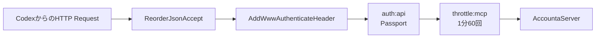
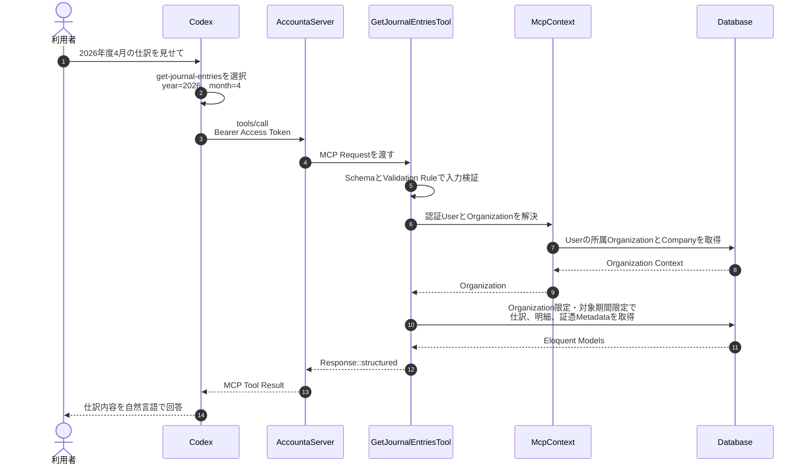
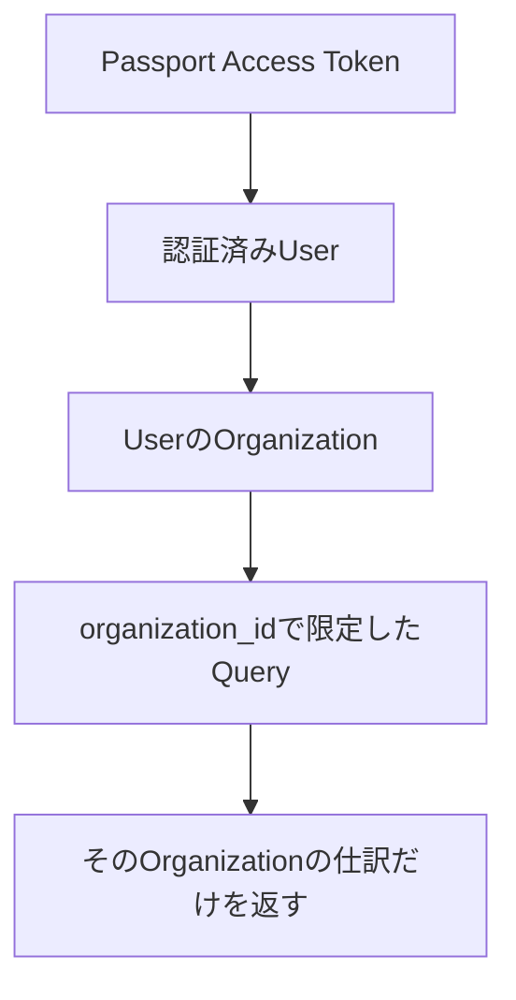
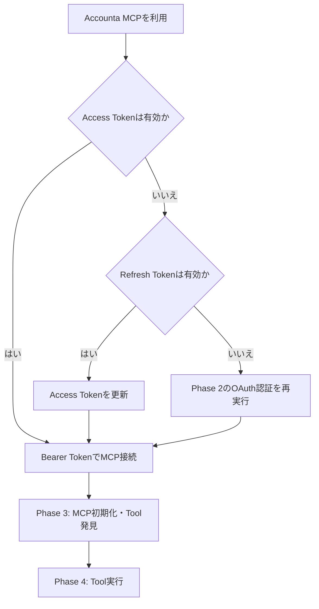
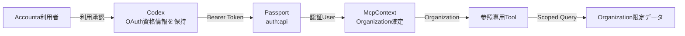

# Accounta v0.4 MCP利用シーケンス

この文書は、CodexがAccounta MCP Serverの設定を読み込み、OAuthでAccounta利用者を認証し、MCP Toolを通じて仕訳データを取得するまでのシーケンスを定義する。

詳細な機能・セキュリティ要件は [v0.4 MCPサーバー](v0.4_MCPサーバー.md) を正とする。

---

## 1. 全体構成

Accounta MCPの利用は、次の4つのPhaseで構成する。



| Phase | 目的 | 完了時にできること |
| --- | --- | --- |
| Phase 1 | CodexへAccounta MCP Serverの接続先を登録する | CodexのMCP servers一覧に`accounta`が表示される |
| Phase 2 | Accounta利用者としてCodexをOAuth認証する | CodexがAccess TokenとRefresh Tokenを保持する |
| Phase 3 | MCP接続を初期化し、公開Toolを発見する | Codexが`get-journal-entries`を利用可能なToolとして認識する |
| Phase 4 | 自然言語の依頼をTool呼び出しへ変換する | 認証UserのOrganizationに限定された仕訳を取得できる |

---

## 2. 登場コンポーネント

| コンポーネント | 役割 |
| --- | --- |
| Codex | MCP Client。設定読込、OAuth、MCP初期化、Tool選択・呼び出しを行う |
| `.codex/config.toml` | Accounta MCP Serverの名前と接続URLを保持する |
| `php artisan serve` | AccountaとAccounta MCP Serverを同じLaravel Applicationとして起動する |
| Laravel MCP | OAuth発見、動的Client登録、Streamable HTTP、MCP Serverを提供する |
| Laravel Passport | Authorization Code + PKCE、Access Token、Refresh Tokenを管理する |
| Fortify / Web Guard | ブラウザでのAccountaログインSessionを管理する |
| `AccountaServer` | Server情報と公開Tool一覧を定義する |
| `GetJournalEntriesTool` | 仕訳一覧・1件詳細を参照する |
| `McpContext` | 認証Userと所属Organizationを確定する |
| Database | User、Organization、仕訳、明細、証憑メタデータ、OAuth情報を保持する |

`laravel-boost`と`accounta`は別のMCP Serverである。



- `laravel-boost`はCodexが`php artisan boost:mcp`を起動する
- `accounta`はCodexが既に起動している`php artisan serve`へ接続する
- Codexは`accounta`のLaravel Serverを起動しない

---

## 3. Phase 1: MCP Server設定の認識

### 3.1 設定

Accountaリポジトリの `.codex/config.toml` にMCP Serverを定義する。

```toml
[mcp_servers.laravel-boost]
command = "php"
args = ["artisan", "boost:mcp"]

[mcp_servers.accounta]
url = "http://127.0.0.1:8000/mcp/accounta"
```

`accounta`には`url`があるため、CodexはStreamable HTTP Serverとして扱う。`enabled = false`を指定していないため、既定では有効になる。

### 3.2 シーケンス



### 3.3 このPhaseで確定すること

- Codex上のServer識別名は`accounta`
- 接続先は`http://127.0.0.1:8000/mcp/accounta`
- Codex SettingsのMCP servers一覧へ`accounta`が表示される
- トグルONは、そのMCP Server定義が有効であることを示す
- Token、Client Secret、Passport秘密鍵は`.codex/config.toml`へ保存しない

### 3.4 このPhaseでは行わないこと

- AccountaへのOAuthログイン
- OAuth Clientの動的登録
- Access Tokenの発行
- MCPの`initialize`
- `tools/list`または`tools/call`
- 仕訳データの取得

一覧表示は設定ファイルから構成できるため、このPhaseだけならAccountaへのHTTP接続成功は必要ない。

### 3.5 確認

```powershell
codex mcp list
```

OAuth認証前は、`accounta`が`enabled`でも認証状態は`Not logged in`となる。

---

## 4. Phase 2: OAuth認証

### 4.1 前提

Accountaを次のアドレスで起動しておく。

```powershell
php artisan serve
```

```text
http://127.0.0.1:8000
```

`localhost`と`127.0.0.1`はブラウザCookie上では別のホストである。Codexの接続URLに合わせ、Accountaへのブラウザログインも`127.0.0.1`へ統一する。

OAuth認証は、Codex Settingsの`Authenticate`または次のコマンドから開始する。

```powershell
codex mcp login accounta
```

### 4.2 OAuth発見・Client登録・利用承認のシーケンス



### 4.3 Accounta側のEndpoint

`Mcp::oauthRoutes()`により、主に次のEndpointが登録される。

| Method | Endpoint | 役割 |
| --- | --- | --- |
| GET | `/.well-known/oauth-protected-resource` | 保護リソースMetadata |
| GET | `/.well-known/oauth-authorization-server` | Authorization Server Metadata |
| POST | `/oauth/register` | CodexをOAuth Clientとして動的登録 |
| GET | `/oauth/authorize` | AccountaログインUserへ利用承認を要求 |
| POST | `/oauth/authorize` | 利用承認を確定し認可Codeを発行 |
| POST | `/oauth/token` | 認可CodeをTokenへ交換 |

Laravel MCPのMetadataには`registration_endpoint`が含まれる。固定Client IDを`.codex/config.toml`へ設定していないため、CodexはDynamic Client Registrationを利用する。

### 4.4 CallbackとClient登録の制限

- CallbackはCodexが起動する`127.0.0.1`のLoopback Listenerへ戻る
- PortはOAuth開始時に選ばれる可変Portである
- Accountaは`127.0.0.1`、`localhost`、`[::1]`のLoopback Redirectを許可する
- 外部ドメインのRedirect URIは拒否する
- `POST /oauth/register`は同一IPあたり1分10回に制限する
- OAuth発見用GETは登録回数の上限へ含めない

### 4.5 Tokenの役割

| Token | 役割 |
| --- | --- |
| Access Token | `POST /mcp/accounta`のBearer認証に使用する |
| Refresh Token | Access Token期限切れ時の再発行に使用する |

Access TokenはAccounta Userと`mcp:use` Scopeに結び付く。AccountaのUser IDやOrganization IDを`.codex/config.toml`へ固定しない。

---

## 5. Phase 3: MCP初期化・Tool発見

OAuth認証後、CodexはAccess Tokenを付けてAccounta MCP Serverへ接続する。

### 5.1 初期化シーケンス



### 5.2 HTTP Middleware

`POST /mcp/accounta`では、次の順に処理する。



- Tokenがない、無効、期限切れの場合は`401 Unauthorized`を返す
- 401応答にはOAuth発見先を示す`WWW-Authenticate`を付ける
- Rate Limitは同一Access Tokenを基本単位とする
- AccountaのWeb Sessionではなく、Passportの`api` GuardでMCP Requestを認証する

### 5.3 Server情報

`AccountaServer`は初期化応答で次を示す。

| 項目 | 値 |
| --- | --- |
| Name | `Accounta` |
| Version | `0.4.0` |
| Transport | Streamable HTTP |
| Instructions | 参照専用、Organization限定、任意SQL禁止、証憑ファイル非公開 |

### 5.4 公開Tool

`tools/list`が返す業務Toolは次の1件だけである。

```text
get-journal-entries
```

Toolには次のAnnotationを付ける。

| Annotation | 値 | 意味 |
| --- | --- | --- |
| `readOnlyHint` | `true` | データを書き換えない |
| `idempotentHint` | `true` | 同一入力を繰り返しても副作用がない |

Toolの入力Schemaは次のとおりである。

| 引数 | 内容 |
| --- | --- |
| `year` | 会計年度。省略時は当年度 |
| `month` | 会計月。`year`がない場合は無視 |
| `journal_entry_id` | 仕訳1件を指定 |
| `limit` | 一覧件数。既定50、最大200 |

---

## 6. Phase 4: Tool実行・データ取得

利用者が自然言語で仕訳を依頼すると、CodexはTool定義と入力Schemaを基に`get-journal-entries`を選択する。

### 6.1 Tool呼び出しシーケンス



### 6.2 Organizationの決定

OrganizationはTool引数から受け取らない。



- `$request->user()`から認証Userを取得する
- Userの`organization` Relationから対象Organizationを決定する
- `organization_id`をTool入力として公開しない
- UserまたはOrganizationを解決できない場合はTool Errorを返す
- 他Organizationの`journal_entry_id`は、存在していても「見つからない」として扱う
- 他OrganizationのIDや件数をErrorへ含めない

### 6.3 一覧取得

一覧取得では次を適用する。

1. Companyの`fiscal_year_start_month`から会計年度期間を算出する
2. `year`と`month`があれば対象月へ絞り込む
3. 認証UserのOrganizationへ限定する
4. 仕訳日降順、同一日はID降順で並べる
5. `limit`件を返す。既定50件、最大200件
6. `count`には対象期間の総件数ではなく、実際に返した件数を入れる

### 6.4 1件取得

`journal_entry_id`を指定した場合は、期間と`limit`に関係なく1件を取得する。ただしOrganization Scopeは必ず適用する。

```text
journal_entry_idが自Organizationに存在する
  └─ 仕訳、明細、証憑Metadataを返す

journal_entry_idが存在しない、または他Organizationに存在する
  └─ 「仕訳が見つかりません」を返す
```

### 6.5 Tool応答

Toolは`Response::structured()`で次を返す。

- 対象期間
- 返却した仕訳件数
- 仕訳ID、仕訳日、摘要、備考、起票部門コード
- 借方合計、貸方合計
- 明細の貸借、科目コード・名称、部門コード、金額、摘要
- 証憑ID、元ファイル名、MIME Type、ファイルサイズ、登録日時

次は返さない。

- 証憑ファイル本体
- Storage Disk名
- 保存Path
- OCR結果
- 任意SQLの実行結果
- 他Organizationのデータ

### 6.6 Tool呼び出し例

会計年度の一覧:

```json
{
  "year": 2026
}
```

会計年度内の月指定:

```json
{
  "year": 2026,
  "month": 4
}
```

仕訳1件:

```json
{
  "journal_entry_id": 123
}
```

---

## 7. 2回目以降の利用

OAuth資格情報が有効である間、Codexは保存済みのAccess Tokenを使ってPhase 3以降を実行する。毎回ブラウザで承認する必要はない。



次の場合はOAuth認証の再実行が必要になることがある。

- Refresh Tokenが失効した
- OAuth ClientまたはTokenをDatabaseから削除した
- Passport鍵を互換性なく再生成した
- Codex側の保存済み資格情報を削除した
- Server URLまたはOAuth Issuerを変更した

---

## 8. 操作と確認コマンド

### Accountaを起動

```powershell
php artisan serve
```

### MCP設定を確認

```powershell
codex mcp list
```

### OAuth認証を開始

```powershell
codex mcp login accounta
```

### Codex上のServer・Toolを確認

CodexのComposerで次を実行する。

```text
/mcp
```

詳細な接続診断を表示する場合は次を使用する。

```text
/mcp verbose
```

---

## 9. セキュリティ境界



- CodexのAccounta PasswordをTokenや設定ファイルへ保存しない
- `.codex/config.toml`へAccess Token、Refresh Token、Client Secretを書かない
- Passport秘密鍵をGit管理しない
- MCP Requestは`auth:api`を通す
- Toolは接続UserのOrganizationだけを参照する
- 公開Toolは`get-journal-entries`の1つだけとする
- 登録、更新、削除、任意SQLを公開しない

---

## 10. 参考資料

- [OpenAI公式: Model Context Protocol](https://learn.chatgpt.com/docs/extend/mcp)
- [Accounta v0.4 MCPサーバー詳細設計](v0.4_MCPサーバー.md)

